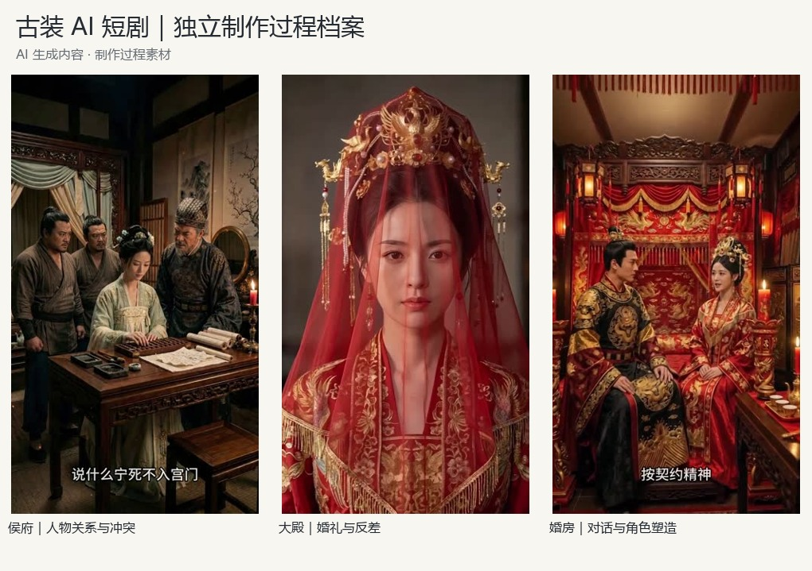
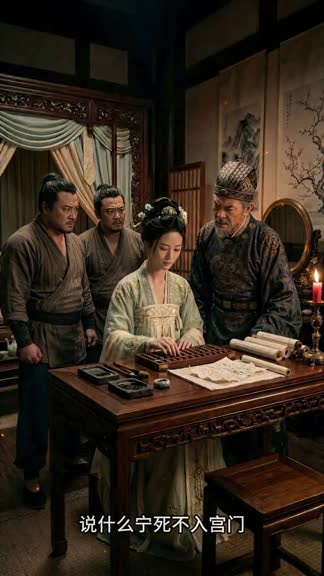

独立制作 · AI 短剧 · 第一集

<h1 align="center">替嫁嫡妹</h1>

角色、分镜、声音与镜头，最终汇入一条时间线。

**[打开交互式作品集](https://namgnal.github.io/ai-short-drama-showcase/)** · [观看成片预览](media/final-preview.mp4) · [制作流程](docs/workflow.md) · [角色参考](docs/characters.md) · [分场与分镜](docs/scenes.md) · [版本迭代](docs/iterations.md)

本项目同时包含交互式案例页 `index.html`：可播放视频、切换三场分镜、放大角色图、筛选素材。下载并解压后可直接在浏览器打开；部署为静态站点后可在线浏览。GitHub 仓库中的 HTML 源文件页不会直接呈现完整网站。

## 从构想到成片

《替嫁嫡妹》第一集，约 **2 分 43 秒**，三场戏，竖屏古装 AI 短剧。独立承担剧本与分镜设计、角色及场景素材、AI 视频生成、配音配乐，并使用 **剪映** 完成镜头剪辑、音画整合、字幕处理与成片导出。

原片为 1080 × 1920、60fps；本仓库提供 720 × 1280、30fps 轻量预览。画面及部分音频为 AI 生成内容。

## 制作流程与证据

| 环节 | 创作工作 | 可查看的材料 |
|---|---|---|
| 剧本与分镜 | 按三场戏组织人物、动作与对白 | [分场与分镜](docs/scenes.md) |
| 角色与场景 | 准备多角度、服装与场景参考 | [角色图集](docs/characters.md) |
| 分镜首帧 | 明确景别、人物站位和构图 | [首帧素材](docs/assets.md) |
| 镜头生成 | 独立镜头生成后进入分场组合 | [镜头与分场样例](docs/workflow.md#镜头生成与分场剪辑) |
| 剪映后期 | 画面、声音、字幕与节奏整合 | [音频与后期](docs/workflow.md#对白与音频素材) |
| 版本留存 | 保存问题版、修订版和终稿 | [版本记录](docs/iterations.md) |

## 三场戏

| 侯府 | 大殿 | 婚房 |
|---|---|---|
|  |  |  |
| 人物关系与冲突 | 婚礼与反差 | 对话与角色塑造 |
| [观看分场](media/scenes/scene-1.mp4) | [观看分场](media/scenes/scene-2.mp4) | [观看分场](media/scenes/scene-3.mp4) |

## 工具与素材范围

本片主要内容在 **Runway 和即梦** 中完成，使用 **剪映** 进行剪辑与后期。主要工具依据创作者的实际制作说明确认；其他原始文件名中的工具信息仅作为素材来源线索，详见[来源说明](docs/provenance.md)。

原始材料包含 99 个文件，经 SHA-256 去重为 95 份不同内容。本包选取角色与分镜图、9 个视频预览、4 条对白样例及过程文档。完整母版与原路径映射保留在本地。

本案例由现存文件与制作说明整理，未包含独立剧本文档、提示词全文、逐次生成参数或可编辑剪辑工程。未编造缺失的历史操作记录或量化效果。

[素材索引](docs/assets.md) · [机器可读清单](catalog/assets.json) · [来源说明](docs/provenance.md) · [使用说明](USAGE.md)

公开包仅含作品与过程材料，以“独立创作者”署名，不包含实名报名资料、联系方式、录用材料或原始电脑路径。公开展示不等于授予素材开放再利用许可。
