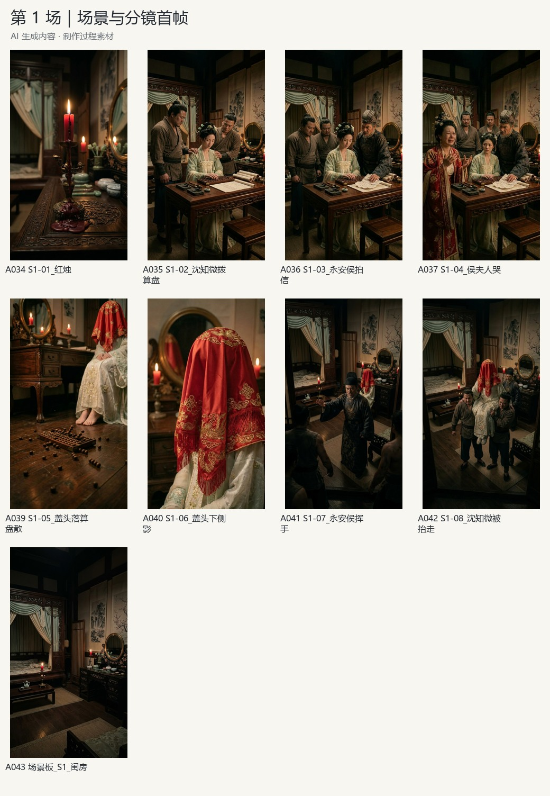
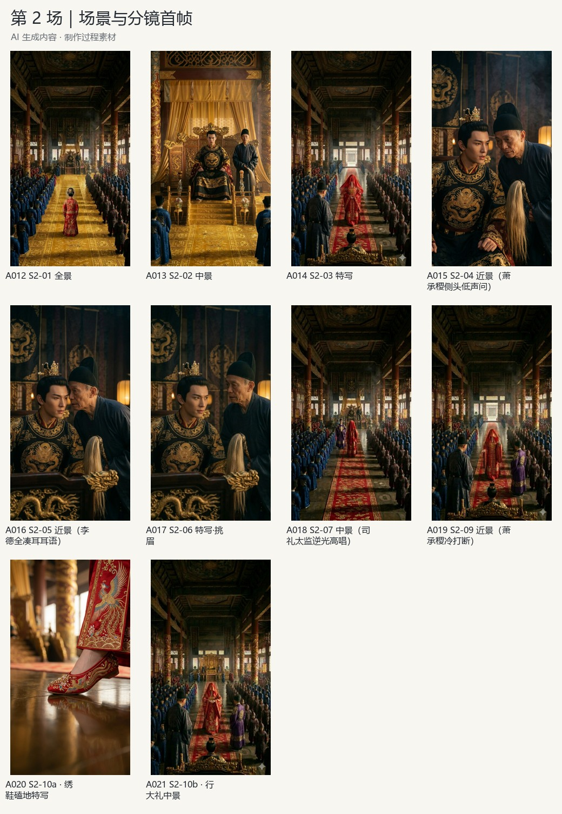
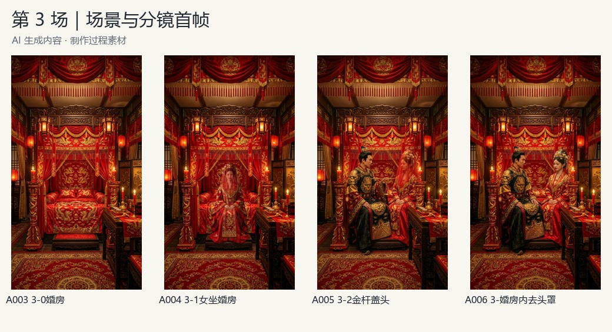

# 分场与分镜

[返回首页](../README.md) · [素材索引](assets.md)

场景称谓依据画面整理，用于检索。分场导出的时长不是终稿中精确的剪辑边界。

## 第一场：侯府

红烛、算盘、父母与女儿的互动，以及盖头、离场等画面。原目录保留 S1-01 至 S1-08 的首帧及一张场景板。

[第一场分场剪辑，约 50.69 秒](../media/scenes/scene-1.mp4) · [生成镜头示例](../media/clips/scene-1-example.mp4)

## 第二场：大殿

包含大殿空间、人物对话、耳语、绣鞋特写与行礼画面。原文件的 S2-08 缺失，S2-10 分为 a / b，按原编号保留。个别原文件中的景别标签与画面构图不完全对应，索引保留原标签，不将其作为专业判断结论。

[第二场分场剪辑，约 44.24 秒](../media/scenes/scene-2.mp4) · [生成镜头示例](../media/clips/scene-2-example.mp4)

## 第三场：婚房

包含婚房空景、人物落座、揭盖头及对话参考。此部分原命名不统一，按内容归组，没有补造正式分镜号。

[第三场分场剪辑，约 67.85 秒](../media/scenes/scene-3.mp4) · [生成镜头示例](../media/clips/scene-3-example.mp4)
